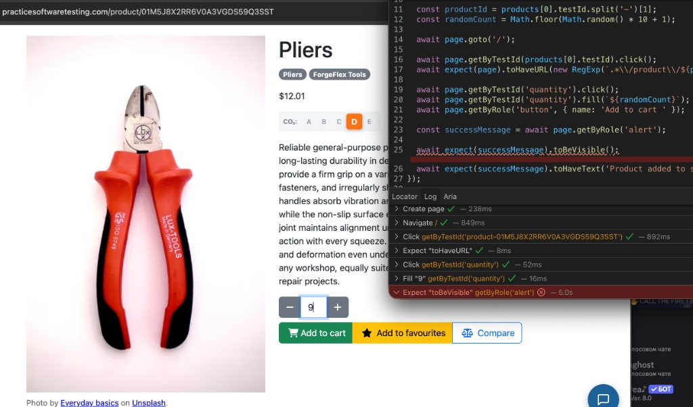
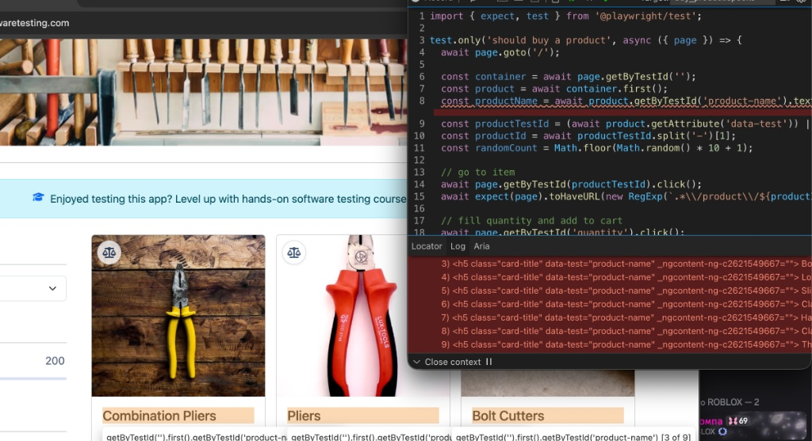

# Here is review of my test and what i changed based on AI results

## Test case 1. Register a new customer

### Description of test case

A unique new account is created and the user ends up signed in or on the login page

### Where i used AI and why

- I wrote first demo test by myself. There was raw url link to https://practicesoftwaretesting.com/ . In AI first review, he said that i can write baseURL in playwright.config.ts, so i can write '/' path in my project.
- Second time i used AI when i got stuck in debug process. I runned npx playwright --project=chromium (to check only chromium while debugging to make test writing process faster) --debug. The AI said that the problem might be that when i used getByTestId, Playwright is seeking for data-test-id, so i checked the html and there is data-test. Firstly, i thought it may find it and there will be no problem. So i changed test attribute in playwright config and it worked.
- I asked him to write me a pattern, so i do not have to write exact url path to check.

## Test case 2. Log in

### Description of test case

Valid credentials reach the account page; invalid ones show the error and do not

### Where i used AI and why

- Wrote two tests by myself. Then after tests successfully completed, i shared my code with AI to do review of my code. He suggested me to use beforeEach to not duplicate first rows in each login test. So i refactored my code where i used test.describe and beforeEach
- After i finished all test cases. I ran all of them again and unexpectedly login test case failed on successful login on each browser. I used one credential for login that worked when i was writing a test, then the account credentials started to give error message with too many failed attempts. So to test successful login, i created array with 3 test user credentials, if any of them fails, it goes to next. I faced problem where test runs faster than site works. On the site when account can not be logged in, it shows error message, but not fast enough and my test goes to check url. After unsuccessful attempts to fix it, I asked Claude to solve the problem, he gave me the solution for this race condition. So i implemented it.

## Test case 3. Buy a product

### Description of test case

Add to cart → cart shows the right item and quantity → checkout completes

### Where i used AI and why

- asked for how to put a variable into url pattern check. Recommended to use new RegExp
- 
  Here forgot to use click() for button. AI helped to find mistake
- in first tests i hardcoded data-test, then i found that items data-test changes sometimes, so i asked AI how can i get first element of container. Further, when i saw that some tests got error, because first item sometimes can be out of stock. So i prompted to AI how can i write a loop, so if first item is out of stock, check the next item and so on
- asked for getAttribute functionality. I had some suggestions, but wanted to be sure
- 
  wrong using first() to locator, AI helped to fix

## Test case 4. Compare two products

### Description of test case

Open two products, capture name and price, assert the comparison you state

### Where i used AI and why

- No AI usage

## Test case 5. Reset a password

### Description of test case

The forgot-password flow gives the expected confirmation for a known email, and an error for an invalid one

### Where i used AI and why

- No AI usage
